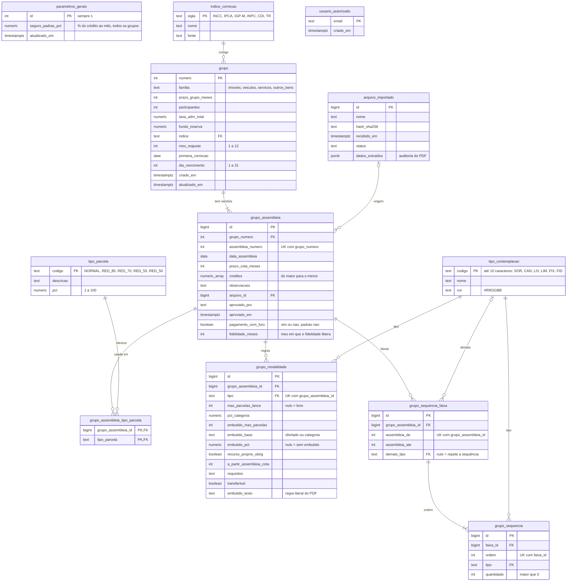

# Dinastia · MER (modelo entidade-relacionamento)

Atualizado em 15/10/2026 · versão 0036 · conferido tabela a tabela, coluna a coluna, com o banco em produção (Supabase, schema `public`).

Desenho para baixar: `docs/MER.png` (imagem) e `docs/MER.svg` (vetorial).

Mudanças desde o MER de 09/10/2026:
- **Esquema: nenhuma.** As 12 tabelas, colunas, chaves, unicidades e índices continuam como no MER anterior (última migração de esquema: 0010).
- Correções de **dados** (sem mudar o esquema): 0011 (ordem do fidelidade nos grupos 800, 820 e 830) e 0012 (grupo 770: lance livre limitado a 72 parcelas).
- Volumes atualizados (abaixo); `arquivo_importado` e `usuario_autorizado` agora constam na lista de volumes.

Mudanças do MER de 09/10/2026 (para referência):
- Sorteio Cancelada passou de `SOC` para `CAN` (0009); função `salvar_sequencia` refaz as faixas de uma versão (0010).
- `grupo_assembleia` ganhou `pagamento_com_furo` (0006/0007) e `fidelidade_meses` (0008).
- `tipo_contemplacao` ganhou `cor` (`#RRGGBB`) e o `codigo` passou a ter no máximo 10 caracteres (`SOR`, `CAN`, `LIV`, `LIM`, `FIX`, `FID`) — migração 0005.
- `grupo.seguro_pct_mes` saiu; o seguro prestamista é só `parametros_gerais.seguro_padrao_pct` — migração 0004.

## Leitura rápida

- **Grupo** guarda o que é estável (prazo, taxa, índice, vencimento). Cada PDF de assembleia vira uma linha em **grupo_assembleia**; a de maior `assembleia_numero` é a vigente (view `grupo_atual`).
- Dentro de cada versão: créditos (lista), tipos de parcela oferecidos, regras por modalidade e a sequência de contemplação por faixas de assembleias.
- `tipo_contemplacao`, `tipo_parcela` e `indice_correcao` são cadastros de apoio; `parametros_gerais` tem uma linha só.
- `usuario_autorizado` controla o acesso: as outras 11 tabelas têm RLS com a policy `autorizado_tudo` (via `autorizado()`); ela própria não tem policy, ou seja, é invisível pela API (por isso a exportação para Excel do app não a inclui); não se relaciona com as demais.
- As chaves para `tipo_contemplacao`, `tipo_parcela` e `indice_correcao` têm `on update cascade`: trocar um código atualiza os grupos.

## Objetos do banco além das tabelas

- **View** `grupo_atual`: uma linha por grupo com os dados da versão vigente (maior `assembleia_numero`).
- **Funções**: `importar_grupo(p jsonb)` grava uma versão completa (usada na importação de PDF e na restauração de backup); `salvar_sequencia(p jsonb)` refaz as faixas e a sequência de uma versão; `autorizado()` diz se o usuário logado está em `usuario_autorizado` (base das policies de RLS); `set_atualizado_em()` é a função dos gatilhos que atualizam `atualizado_em` em `grupo` e `parametros_gerais`.
- **Unicidades**: `grupo_assembleia (grupo_numero, assembleia_numero)`, `grupo_modalidade (grupo_assembleia_id, tipo)`, `grupo_sequencia_faixa (grupo_assembleia_id, assembleia_de)`, `grupo_sequencia (faixa_id, ordem)`.
- **Índices** extras: em todas as chaves estrangeiras e `grupo_assembleia (grupo_numero, assembleia_numero desc)` para achar a versão vigente.
- `arquivo_importado.status`: hoje as 144 linhas estão `aprovado`.

## Volumes em 15/10/2026

grupo 144 · arquivo_importado 144 · grupo_assembleia 144 · grupo_modalidade 842 · grupo_sequencia_faixa 306 · grupo_sequencia 1.853 · grupo_assembleia_tipo_parcela 381 · tipo_contemplacao 6 · tipo_parcela 5 · indice_correcao 6 · parametros_gerais 1 · usuario_autorizado 1
