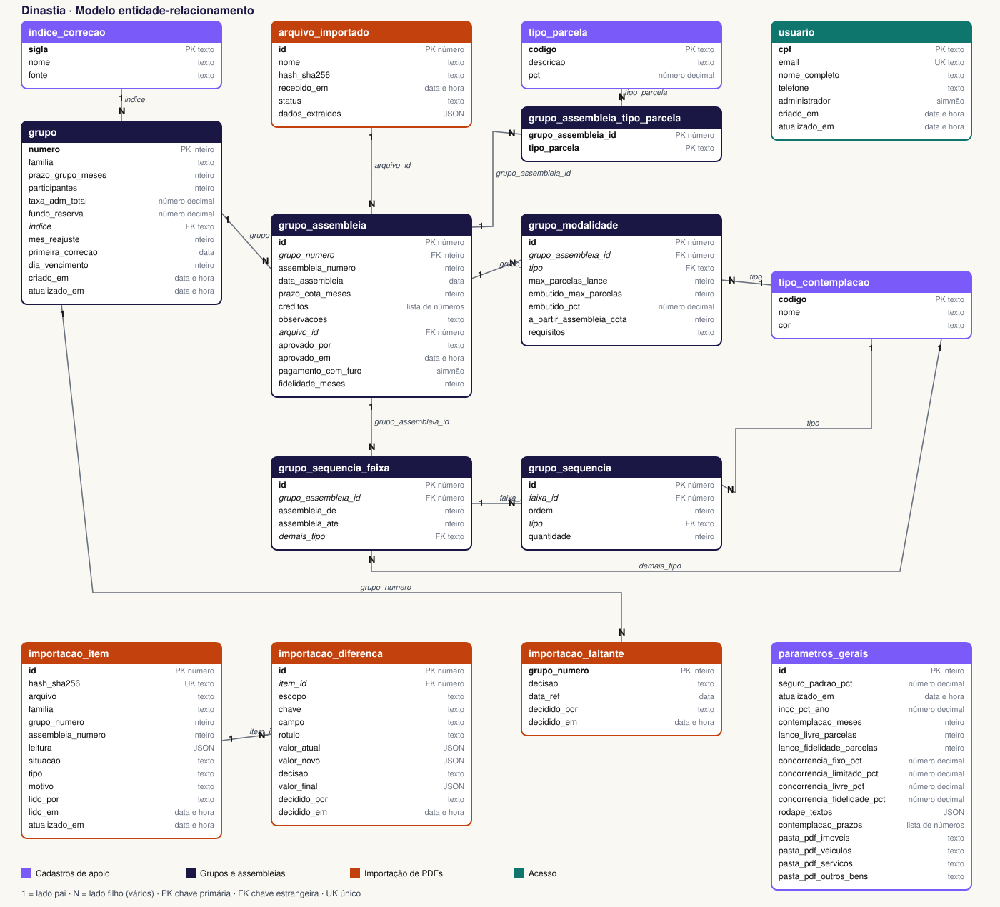
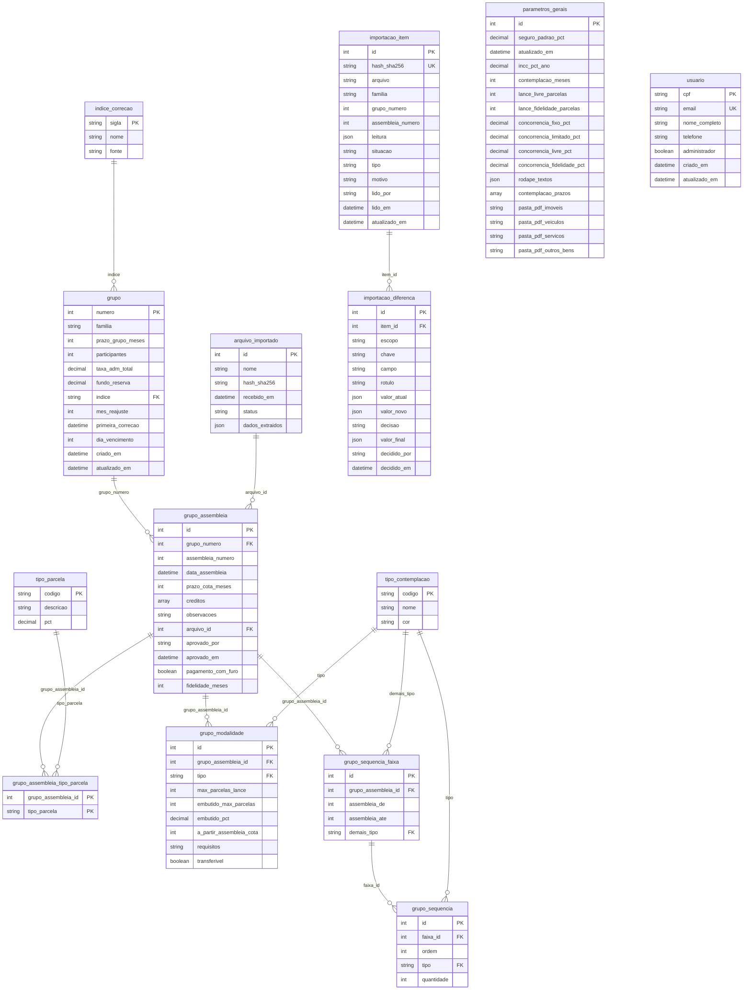

# Dinastia · Modelo de dados

Gerado de `src/lib/dicionarioDados.ts` (rode `npx tsx scripts/gerar_docs.mts`). Banco: PostgreSQL (Supabase). Ao mudar uma tabela, atualize o dicionário na mesma entrega.

## Modelo entidade-relacionamento

(O desenho acima, `docs/modelo-er.svg`, é mantido à mão; o diagrama abaixo é gerado e acompanha o dicionário.)

Cada linha liga a tabela "pai" (1) às tabelas "filhas" (vários). `grupo_assembleia` é o centro: cada grupo tem uma versão por assembleia, e cada versão tem seus tipos de parcela, modalidades e sequência.

## Relacionamentos

| Tabela filha | Campo | Tabela pai | Campo | Ao apagar o pai | Significado |
|---|---|---|---|---|---|
| grupo | indice | indice_correcao | sigla | bloqueia | Cada grupo usa um índice de correção. |
| grupo_assembleia | grupo_numero | grupo | numero | apaga junto | Um grupo tem várias versões, uma por assembleia. |
| grupo_assembleia | arquivo_id | arquivo_importado | id | bloqueia | Cada versão veio de um PDF registrado. |
| grupo_assembleia_tipo_parcela | grupo_assembleia_id | grupo_assembleia | id | apaga junto | Tipos de parcela oferecidos na versão. |
| grupo_assembleia_tipo_parcela | tipo_parcela | tipo_parcela | codigo | bloqueia | Qual tipo de parcela. |
| grupo_modalidade | grupo_assembleia_id | grupo_assembleia | id | apaga junto | Regras de lance da versão. |
| grupo_modalidade | tipo | tipo_contemplacao | codigo | bloqueia | De qual modalidade é a regra. |
| grupo_sequencia_faixa | grupo_assembleia_id | grupo_assembleia | id | apaga junto | Faixas da sequência de contemplação da versão. |
| grupo_sequencia_faixa | demais_tipo | tipo_contemplacao | codigo | bloqueia | Modalidade das demais contemplações. |
| grupo_sequencia | faixa_id | grupo_sequencia_faixa | id | apaga junto | Itens (ordem) de cada faixa. |
| grupo_sequencia | tipo | tipo_contemplacao | codigo | bloqueia | Modalidade do item da sequência. |
| importacao_diferenca | item_id | importacao_item | id | apaga junto | Diferenças encontradas em cada PDF lido. |

## Dicionário de dados

### Cadastros de apoio

#### `parametros_gerais`

Parâmetros globais do sistema. Tem sempre uma única linha (id = 1). Tela: Cadastros › Parâmetros globais (só administrador altera).

| Campo | Tipo | Obrig. | Chave | Descrição |
|---|---|---|---|---|
| `id` | inteiro | sim | PK | Sempre 1: a tabela guarda uma linha só. |
| `seguro_padrao_pct` | número decimal | não |  | Seguro prestamista, em % do crédito ao mês, usado no cálculo de todos os grupos. |
| `atualizado_em` | data e hora | sim |  | Última alteração da linha (automático). |
| `incc_pct_ano` | número decimal | sim |  | INCC projetado, em % ao ano, com que o simulador abre (o simulador pode alterar na tela, sem mudar o parâmetro). |
| `contemplacao_meses` | inteiro | sim |  | Mês de contemplação com que o simulador abre. |
| `lance_livre_parcelas` | inteiro | sim |  | Parcelas do lance livre com que o simulador abre. |
| `lance_fidelidade_parcelas` | inteiro | sim |  | Parcelas do lance fidelidade com que o simulador abre. |
| `concorrencia_fixo_pct` | número decimal | sim |  | % de concorrência do lance fixo, mostrado no cabeçalho da coluna do simulador. |
| `concorrencia_limitado_pct` | número decimal | sim |  | % de concorrência do lance limitado. |
| `concorrencia_livre_pct` | número decimal | sim |  | % de concorrência do lance livre. |
| `concorrencia_fidelidade_pct` | número decimal | sim |  | % de concorrência do lance fidelidade. |
| `rodape_textos` | JSON | sim |  | Título e texto sob o prazo restante de cada coluna do simulador, por tipo (SOR, FIX, LIM, LIV, FID). |
| `contemplacao_prazos` | lista de números | sim |  | Os 7 prazos (em meses) que aparecem como atalhos no campo “Contemplação em” do simulador. |
| `pasta_pdf_imoveis` | texto | não |  | Pasta padrão dos PDFs das tabelas de Imóveis (referência para a importação). |
| `pasta_pdf_veiculos` | texto | não |  | Pasta padrão dos PDFs das tabelas de Veículos. |
| `pasta_pdf_servicos` | texto | não |  | Pasta padrão dos PDFs das tabelas de Serviços. |
| `pasta_pdf_outros_bens` | texto | não |  | Pasta padrão dos PDFs das tabelas de Outros Bens. |

#### `indice_correcao`

Índices de correção monetária que os grupos podem usar (INCC, IPCA, IGP-M…).

| Campo | Tipo | Obrig. | Chave | Descrição |
|---|---|---|---|---|
| `sigla` | texto | sim | PK | Sigla do índice (INCC, IPCA, IGP-M, INPC, CDI, TR). |
| `nome` | texto | sim |  | Nome por extenso. |
| `fonte` | texto | não |  | Instituição que divulga o índice. |

#### `tipo_contemplacao`

Modalidades de contemplação: SOR (sorteio ativo), LIV (lance livre), LIM (limitado), FIX (fixo) e FID (fidelidade). Tela: Cadastros › Modalidades de Contemplação.

| Campo | Tipo | Obrig. | Chave | Descrição |
|---|---|---|---|---|
| `codigo` | texto | sim | PK | Código curto da modalidade (SOR, LIV, LIM, FIX, FID). |
| `nome` | texto | sim |  | Nome exibido nas telas. |
| `cor` | texto | sim |  | Cor da modalidade (#RRGGBB) usada nos quadros e na sequência. |

#### `tipo_parcela`

Tipos de parcela (forma de pagamento): normal e reduzidas. Tela: Cadastros › Tipos de Parcela.

| Campo | Tipo | Obrig. | Chave | Descrição |
|---|---|---|---|---|
| `codigo` | texto | sim | PK | Código do tipo (NORMAL, RED_85, RED_70, RED_55, RED_50). |
| `descricao` | texto | sim |  | Descrição exibida nas telas. |
| `pct` | número decimal | sim |  | Percentual da parcela cheia que o tipo representa (100 = normal; 50 = reduzida a 50%). |

### Grupos e assembleias

#### `grupo`

Dados estáveis de cada grupo de consórcio (uma linha por grupo). O que muda a cada assembleia fica em grupo_assembleia. O seguro prestamista é global (parametros_gerais).

| Campo | Tipo | Obrig. | Chave | Descrição |
|---|---|---|---|---|
| `numero` | inteiro | sim | PK | Número do grupo na administradora. |
| `familia` | texto | sim |  | Família do bem: imoveis, veiculos, servicos ou outros_bens. |
| `prazo_grupo_meses` | inteiro | sim |  | Prazo total do grupo, em meses. |
| `participantes` | inteiro | não |  | Número de participantes (cotas) do grupo. |
| `taxa_adm_total` | número decimal | não |  | Taxa de administração total, em % (ex.: 24,00). |
| `fundo_reserva` | número decimal | não |  | Fundo de reserva, em %. Nos imóveis é 0, salvo se o PDF disser outro valor; vazio = não informado. |
| `indice` | texto | não | FK→indice_correcao.sigla | Índice de correção do grupo. |
| `mes_reajuste` | inteiro | não |  | Mês do reajuste anual (1 a 12). |
| `primeira_correcao` | data | não |  | Data da primeira correção, quando o PDF informa. |
| `dia_vencimento` | inteiro | não |  | Dia do mês do vencimento das parcelas (1 a 31). |
| `criado_em` | data e hora | sim |  | Quando a linha foi criada (automático). |
| `atualizado_em` | data e hora | sim |  | Última alteração da linha (automático). |

#### `grupo_assembleia`

Versão de um grupo em cada assembleia (cada PDF aprovado gera uma). A de maior número é a vigente, que o simulador usa.

| Campo | Tipo | Obrig. | Chave | Descrição |
|---|---|---|---|---|
| `id` | número | sim | PK | Identificador da versão. |
| `grupo_numero` | inteiro | sim | UK (com assembleia_numero) · FK→grupo.numero | Grupo a que a versão pertence. |
| `assembleia_numero` | inteiro | sim |  | Número da assembleia (a 122ª, a 7ª…). Um grupo não repete o número. |
| `data_assembleia` | data | não |  | Data em que a assembleia acontece. |
| `prazo_cota_meses` | inteiro | sim |  | Prazo restante da cota nesta assembleia (prazo do grupo − (assembleia − 1)). |
| `creditos` | lista de números | sim |  | Créditos oferecidos na versão, do maior para o menor. |
| `observacoes` | texto | não |  | Avisos do PDF (sequência com mais de uma modalidade, entregas condicionadas, sorteio pela Loteria Federal…). |
| `arquivo_id` | número | não | FK→arquivo_importado.id | PDF de onde veio a versão. |
| `aprovado_por` | texto | não |  | Quem aprovou a importação. |
| `aprovado_em` | data e hora | não |  | Quando a versão foi aprovada. |
| `pagamento_com_furo` | sim/não | sim |  | O grupo permite pagamento com furo nesta versão? Padrão: não. |
| `fidelidade_meses` | inteiro | não |  | Assembleia da cota a partir da qual o lance fidelidade libera (ex.: 37 = após 36 parcelas pagas). Vazio = sem fidelidade ou não informado. |

#### `grupo_assembleia_tipo_parcela`

Quais tipos de parcela (formas de pagamento) cada versão do grupo oferece. Relação muitos para muitos entre grupo_assembleia e tipo_parcela.

| Campo | Tipo | Obrig. | Chave | Descrição |
|---|---|---|---|---|
| `grupo_assembleia_id` | número | sim | PK · FK→grupo_assembleia.id | Versão do grupo. |
| `tipo_parcela` | texto | sim | PK · FK→tipo_parcela.codigo | Tipo de parcela oferecido. |

#### `grupo_modalidade`

Regras de cada modalidade de lance em cada versão do grupo. O % do lance em relação à categoria não é guardado (= máx. de parcelas ÷ prazo do grupo) e o recurso próprio também não (= lance − embutido).

| Campo | Tipo | Obrig. | Chave | Descrição |
|---|---|---|---|---|
| `id` | número | sim | PK | Identificador da regra. |
| `grupo_assembleia_id` | número | sim | UK (com tipo) · FK→grupo_assembleia.id | Versão do grupo. |
| `tipo` | texto | sim | FK→tipo_contemplacao.codigo | Modalidade. |
| `max_parcelas_lance` | inteiro | não |  | Máximo de parcelas do lance. Vazio ou igual ao prazo do grupo = qualquer quantidade (aparece como *). |
| `embutido_max_parcelas` | inteiro | não |  | Máximo de parcelas do lance que podem ser embutidas (pagas com a carta de crédito). Vazio = sem limite em parcelas. |
| `embutido_pct` | número decimal | não |  | % do lance ofertado que pode ser embutido. Vazio = sem limite em %. Os dois campos de embutido vazios = a modalidade não permite embutido (100% recurso próprio). |
| `a_partir_assembleia_cota` | inteiro | sim |  | A partir de qual assembleia da cota a modalidade vale (1 = desde o início; fidelidade costuma ser 37). |
| `requisitos` | texto | não |  | Requisitos para usar a modalidade (ex.: 36 parcelas pagas e participação em 36 assembleias, na fidelidade). |
| `transferivel` | sim/não | sim |  | A transferência da cota transfere o benefício? Não, no lance fidelidade (o PDF avisa “a transferência da cota não transfere o benefício”). |

#### `grupo_sequencia_faixa`

Faixas de assembleias da sequência de contemplação (ex.: da 1ª à 36ª; da 37ª à 240ª) de uma versão do grupo.

| Campo | Tipo | Obrig. | Chave | Descrição |
|---|---|---|---|---|
| `id` | número | sim | PK | Identificador da faixa. |
| `grupo_assembleia_id` | número | sim | UK (com assembleia_de) · FK→grupo_assembleia.id | Versão do grupo. |
| `assembleia_de` | inteiro | sim |  | Primeira assembleia da cota da faixa. |
| `assembleia_ate` | inteiro | sim |  | Última assembleia da cota da faixa. |
| `demais_tipo` | texto | não | FK→tipo_contemplacao.codigo | Modalidade das demais contemplações depois da sequência. Vazio = repete a sequência (sem o sorteio). |

#### `grupo_sequencia`

Itens de cada faixa: a ordem em que as modalidades contemplam em cada assembleia.

| Campo | Tipo | Obrig. | Chave | Descrição |
|---|---|---|---|---|
| `id` | número | sim | PK | Identificador do item. |
| `faixa_id` | número | sim | UK (com ordem) · FK→grupo_sequencia_faixa.id | Faixa a que o item pertence. |
| `ordem` | inteiro | sim |  | Posição do item dentro da faixa. |
| `tipo` | texto | sim | FK→tipo_contemplacao.codigo | Modalidade que contempla nesta posição. |
| `quantidade` | inteiro | sim |  | Quantas contemplações dessa modalidade (ex.: 2 sorteios). |

### Importação de PDFs

#### `arquivo_importado`

Registro de cada PDF (ou carga) que originou uma versão de grupo, com o resumo do que foi lido. Serve de auditoria.

| Campo | Tipo | Obrig. | Chave | Descrição |
|---|---|---|---|---|
| `id` | número | sim | PK | Identificador do arquivo. |
| `nome` | texto | sim |  | Nome do arquivo PDF. |
| `hash_sha256` | texto | não |  | Impressão digital (SHA-256) do conteúdo do arquivo. |
| `recebido_em` | data e hora | sim |  | Quando o arquivo foi registrado. |
| `status` | texto | sim |  | Situação do arquivo (recebido ou aprovado). |
| `dados_extraidos` | JSON | não |  | Resumo da leitura do PDF: grupo, assembleia, prazo da cota, taxa e as parcelas diluídas de cada crédito (casos de teste do cálculo). |

#### `importacao_item`

Cada PDF lido na importação e a situação dele. O mesmo conteúdo (hash) nunca entra duas vezes. Tela: Cadastros › Importar tabelas (PDF).

| Campo | Tipo | Obrig. | Chave | Descrição |
|---|---|---|---|---|
| `id` | número | sim | PK | Identificador do item. |
| `hash_sha256` | texto | sim | UK | Impressão digital (SHA-256) do PDF. |
| `arquivo` | texto | sim |  | Nome do arquivo. |
| `familia` | texto | sim |  | Família do bem lida do PDF. |
| `grupo_numero` | inteiro | não |  | Número do grupo lido do PDF. |
| `assembleia_numero` | inteiro | não |  | Número da assembleia lido do PDF. |
| `leitura` | JSON | não |  | Tudo o que o leitor extraiu do PDF. |
| `situacao` | texto | sim |  | pendente, sem_mudanca, aplicado, rejeitado (descartado), ignorado ou erro. |
| `tipo` | texto | não |  | grupo_novo, nova_assembleia, mesma_assembleia ou anterior (em relação à base). |
| `motivo` | texto | não |  | Explicação (erro de leitura, duplicado, descartado…). |
| `lido_por` | texto | não |  | E-mail de quem leu o PDF. |
| `lido_em` | data e hora | sim |  | Quando foi lido. |
| `atualizado_em` | data e hora | sim |  | Última alteração da linha (automático). |

#### `importacao_diferenca`

Cada diferença entre um PDF e a base, com a decisão do administrador (aceitar, rejeitar ou editar). Nada vai para a base antes de tudo estar decidido.

| Campo | Tipo | Obrig. | Chave | Descrição |
|---|---|---|---|---|
| `id` | número | sim | PK | Identificador da diferença. |
| `item_id` | número | sim | UK (com escopo, chave, campo) · FK→importacao_item.id | PDF a que a diferença pertence. |
| `escopo` | texto | sim |  | Onde: grupo, versao, creditos, tipos_parcela, modalidade ou sequencia. |
| `chave` | texto | sim |  | Qual item do escopo (ex.: a modalidade FIX, ou a faixa que começa na 37ª). |
| `campo` | texto | sim |  | Qual campo mudou (* = o item inteiro). |
| `rotulo` | texto | sim |  | Descrição legível da diferença. |
| `valor_atual` | JSON | não |  | Valor que a base tem hoje. |
| `valor_novo` | JSON | não |  | Valor que o PDF traz. |
| `decisao` | texto | sim |  | pendente, aceita, rejeitada ou editada. |
| `valor_final` | JSON | não |  | Valor digitado, quando a decisão é editada. |
| `decidido_por` | texto | não |  | E-mail de quem decidiu. |
| `decidido_em` | data e hora | não |  | Quando decidiu. |

### Acesso

#### `usuario`

Quem pode entrar no Dinastia e se é administrador. Contém dados pessoais (CPF, telefone): proteja o arquivo exportado. Tela: Cadastros › Usuários.

| Campo | Tipo | Obrig. | Chave | Descrição |
|---|---|---|---|---|
| `cpf` | texto | sim | PK | CPF, só dígitos, validado. Chave do cadastro. |
| `email` | texto | sim | UK | E-mail do login (minúsculo, único). |
| `nome_completo` | texto | sim |  | Nome completo. |
| `telefone` | texto | sim |  | Telefone com DDD, só dígitos. |
| `administrador` | sim/não | sim |  | Administrador pode alterar cadastros, grupos, importar PDFs e gerenciar usuários. O sistema nunca fica sem administrador. |
| `criado_em` | data e hora | sim |  | Quando a linha foi criada (automático). |
| `atualizado_em` | data e hora | sim |  | Última alteração da linha (automático). |

#### `usuario_autorizado`

OBSOLETA: lista antiga de e-mails autorizados, substituída por usuario na migração 0023. Sem uso; pode ser removida.

| Campo | Tipo | Obrig. | Chave | Descrição |
|---|---|---|---|---|
| `email` | texto | sim | PK | E-mail autorizado (lista antiga). |
| `criado_em` | data e hora | sim |  | Quando a linha foi criada (automático). |

## Visões e funções de apoio

| Nome | Tipo | Descrição |
|---|---|---|
| `grupo_atual` | visão | Cada grupo com a versão vigente (maior assembleia): é o que a tela Grupos e Tabelas e o simulador leem. |
| `autorizado()` | função | Verdadeira se o e-mail do login está em usuario. Base das regras de leitura. |
| `eh_admin()` | função | Verdadeira se o e-mail do login é de um administrador. Base das regras de gravação. |
| `cpf_valido(texto)` | função | Confere os dígitos verificadores de um CPF. |
| `logins_existentes()` | função | Lista os e-mails que já têm conta de login (só administrador); usada pela tela Usuários. |
| `salvar_sequencia(json)` | função | Troca, numa transação só, as faixas de sequência de uma versão (editor de sequência). |
| `aplicar_importacao(json)` | função | Grava na base o estado final de um grupo e de uma assembleia depois de todas as decisões da importação (só administrador). |
| `set_atualizado_em()` | função | Gatilho que atualiza o campo atualizado_em a cada alteração. |
